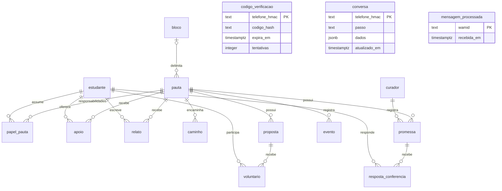

# Contrato inicial do banco

SCRUM-77 · versão inicial para validação da equipe · PostgreSQL 17.

O contrato executável está em `packages/db/src/schema.ts`; o SQL revisável e seus metadados
ficam em `packages/db/migrations/`. Não edite uma migração já aplicada: altere o schema e gere
uma migração nova com `pnpm db:generate`. O gerador não precisa de conexão ao banco.

## Diagrama ER



`pauta.bloco_id` é opcional (campus inteiro quando nulo). Código e conversa não referenciam
estudante: ambos podem existir antes do cadastro. Todas as 16 FKs têm `ON DELETE RESTRICT`.

## Campos, nulabilidade e defaults

Todas as colunas são obrigatórias, exceto as listadas como opcionais abaixo. IDs de entidade
são UUID com `gen_random_uuid()`. Instantes são `timestamp with time zone`; `prazo` e
`data_entrega` são `date`, tratados como dia civil e representados por string no TypeScript.
HMACs e conteúdo cifrado são textos opacos; sua codificação será definida na implementação
da cifra. Os campos sem tipo indicado são `text`, exceto FKs UUID e enums listados adiante.

| Tabela               | Campos                                                                                                                                            | Opcionais                                                | Defaults / chaves                                                                   |
| -------------------- | ------------------------------------------------------------------------------------------------------------------------------------------------- | -------------------------------------------------------- | ----------------------------------------------------------------------------------- |
| estudante            | id, telefone_hmac, telefone_cifrado, email_hmac, email_cifrado, curso, verificado_em, saiu_em                                                     | email_hmac, email_cifrado, curso, verificado_em, saiu_em | PK id; telefone_hmac e email_hmac únicos                                            |
| codigo_verificacao   | telefone_hmac, codigo_hash, expira_em, tentativas (integer)                                                                                       | nenhum                                                   | PK telefone_hmac; tentativas = 0 e >= 0                                             |
| bloco                | id, slug, nome, base_estudantes (integer)                                                                                                         | nenhum                                                   | PK id; slug único; base_estudantes >= 0                                             |
| pauta                | id, slug, titulo, descricao, bloco_id, categoria, status, meta (integer), criada_em, aprovada_em, meta_batida_em, motivo_recusa, busca (tsvector) | bloco_id, aprovada_em, meta_batida_em, motivo_recusa     | PK id; slug único; status = em_curadoria; criada_em = now(); meta > 0; busca gerada |
| papel_pauta          | pauta_id, estudante_id, papel, desde, ate, ultima_atividade_em                                                                                    | ate                                                      | PK (pauta_id, estudante_id, desde); desde e ultima_atividade_em = now()             |
| apoio                | pauta_id, estudante_id, origem, criado_em                                                                                                         | nenhum                                                   | PK (pauta_id, estudante_id); criado_em = now()                                      |
| relato               | id, pauta_id, estudante_id, texto, foto_chave, moderacao, moderado_em                                                                             | foto_chave, moderado_em                                  | PK id; moderacao = pendente                                                         |
| caminho              | id, pauta_id, tipo, status, protocolo, prazo, aberto_em                                                                                           | protocolo, prazo                                         | PK id; aberto_em = now()                                                            |
| proposta             | id, pauta_id, descricao, pessoas_necessarias (integer), status, executada_em                                                                      | executada_em                                             | PK id; status = aberta; pessoas_necessarias > 0                                     |
| voluntario           | proposta_id, estudante_id, criado_em                                                                                                              | nenhum                                                   | PK (proposta_id, estudante_id); criado_em = now()                                   |
| promessa             | id, pauta_id, resumo, data_entrega, fonte, registrada_por, conferencia_abre_em, conferencia_fecha_em, resultado                                   | resultado                                                | PK id; registrada_por referencia curador; uma ativa por pauta                       |
| resposta_conferencia | promessa_id, estudante_id, resposta, criado_em                                                                                                    | nenhum                                                   | PK (promessa_id, estudante_id); criado_em = now()                                   |
| evento               | id, pauta_id, tipo, dados (JSONB), origem, publico (boolean), criado_em                                                                           | nenhum                                                   | PK id; dados = {}; publico = false; criado_em = now()                               |
| conversa             | telefone_hmac, passo, dados (JSONB), atualizado_em                                                                                                | nenhum                                                   | PK telefone_hmac; dados = {}; atualizado_em = now()                                 |
| mensagem_processada  | wamid, recebida_em                                                                                                                                | nenhum                                                   | PK wamid; recebida_em = now()                                                       |
| curador              | id, email_hmac, email_cifrado, nome, ativo (boolean)                                                                                              | nenhum                                                   | PK id; email_hmac único; ativo = true                                               |

A chave de `papel_pauta` inclui `desde` para preservar mandatos históricos. O limite de três
responsáveis ativos pertence ao domínio; a migração não o implementa.

`papel_pauta.desde` é exportado como string pelo Drizzle para preservar os microssegundos do
PostgreSQL. Reutilize esse valor sem convertê-lo para `Date` ao consultar ou atualizar pela PK:
`Date` conserva apenas milissegundos e uma chave truncada pode não encontrar o registro.
Essa escolha não altera a coluna SQL nem exige migração ou arredondamento dos dados existentes.

Não há colunas `telefone` ou `email` em texto puro, inclusive para curador (decisão da dev).
O banco não verifica se o chamador realmente cifrou o valor ou se o JSONB contém dados pessoais:
os contratos de cifra, validação de payloads e acesso do site ainda precisam ser implementados.
Campos identificadores, hashes, cifras e `conversa.dados` ficam no backend.

## Status da pauta

O enum `status_pauta` contém exatamente estes valores. Os rótulos públicos do site precisam
ser validados com a equipe na T7; esta versão não fixa um mapeamento de apresentação.

| Ordem | Valor técnico     |
| ----- | ----------------- |
| 1     | em_curadoria      |
| 2     | recusada          |
| 3     | juntando_apoios   |
| 4     | meta_batida       |
| 5     | cobrando          |
| 6     | prometido         |
| 7     | entregue_em_parte |
| 8     | descumprida       |
| 9     | conquistada       |

Outros enums: `papel_na_pauta` = owner/co_owner; `origem_apoio` = bot/site;
`moderacao_relato` = pendente/aprovado/recusado; `tipo_caminho` = falabr/comunidade/representante;
`status_proposta` = aberta/executada; `resposta_conferencia_valor` = sim/em_parte/nao;
`origem_evento` = bot/curadoria/agendador.

`categoria`, `caminho.status`, `promessa.resultado` e `evento.tipo` são textos sem catálogo
fechado na fonte recebida. Não pressupor valores além dos já acordados em cada integração.

## Índices e invariantes

- Apoio, voluntário, resposta e wamid têm unicidade garantida pelas respectivas PKs.
- Estudante tem telefone HMAC único e e-mail HMAC único quando preenchido. Vários e-mails
  nulos são permitidos durante o cadastro; curador exige ambos os campos de e-mail.
- Promessa ativa significa `resultado IS NULL`. O índice único parcial
  `promessa_ativa_por_pauta_unique` limita uma ativa por pauta mesmo sob concorrência.
  Preencher resultado encerra a promessa; várias encerradas podem coexistir.
- A meta é um inteiro persistido na pauta. Atualizar a base do bloco não a recalcula.
  Cálculo, congelamento no fluxo de criação e transições de status são tarefas do domínio.
- FKs têm índice próprio ou são prefixo de PK composta; evento usa `(pauta_id, criado_em)`.
  Pauta também possui índices por status e bloco_id.
- `pauta.busca` é gerada automaticamente com `to_tsvector('portuguese', titulo || ' ' || descricao)`
  e índice GIN. Inserções/atualizações não devem fornecer essa coluna.

## Uso e verificação

```bash
pnpm db:up
pnpm db:migrate
pnpm db:generate
pnpm check
```

`db:migrate` lê `DATABASE_URL`, carrega o `.env` da raiz quando existir e respeita variáveis já
definidas no processo. Reaplicar o comando usa o journal `drizzle.__drizzle_migrations`;
não recria tabelas nem reseta dados. Importe `criarCliente` de `@lumens/db`, forneça a URL e
encerre o `pool` no ciclo de vida do serviço. Importar o pacote não lê ambiente nem conecta.
Tipos de leitura/inserção de todas as tabelas e `StatusPauta` são exportados pelo pacote.

Os testes exigem `DATABASE_URL_TESTE` apontando para banco terminado em `_test` e usuário com
`CREATEDB` (o usuário do Docker/CI possui essa capacidade). Cada execução cria um banco
`lumens_test_scrum77_<uuid>` com tabelas e journal próprios; ao terminar, fecha conexões e
remove somente esse banco. `lumens` e `lumens_test` são preservados. Se o processo for morto
abruptamente, pode sobrar um banco temporário; confira o nome exato antes de removê-lo.

O CI executa o mesmo SQL de criação do banco de teste usado no Docker e migra uma base vazia
antes dos testes. Testes de integração exercitam o runner real da migração e rejeições por
SQLSTATE e constraint, além da busca, metadados e consumo de tipos pelo domínio.

## Pendências para a equipe

- T5: bloquear UPDATE, DELETE e TRUNCATE em evento; atualmente a tabela ainda é mutável.
- T6: seed com blocos e uma pauta por status, além de `db:fresh`.
- T7: validar diagrama, nulabilidade, enums abertos, resultado/atividade da promessa,
  nomes dos eventos e rótulos públicos com as partes 2 a 5; registrar os participantes e decisões.
- Confirmar nomes reais dos blocos e base DIACOM antes do seed definitivo.
- Domínio/agendador: expiração em dez minutos, máximo de tentativas, retenção de 24h,
  máximo de responsáveis ativos e transições. Os campos existem; as rotinas não estão nesta task.
- Cifra e views públicas: fornecer as garantias de escrita e acesso aos campos protegidos.
