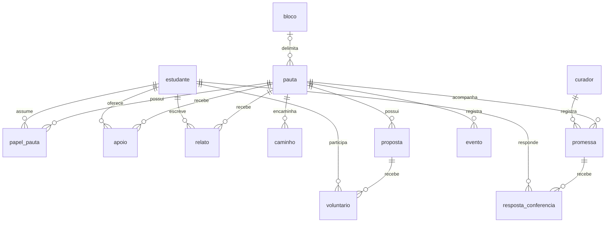
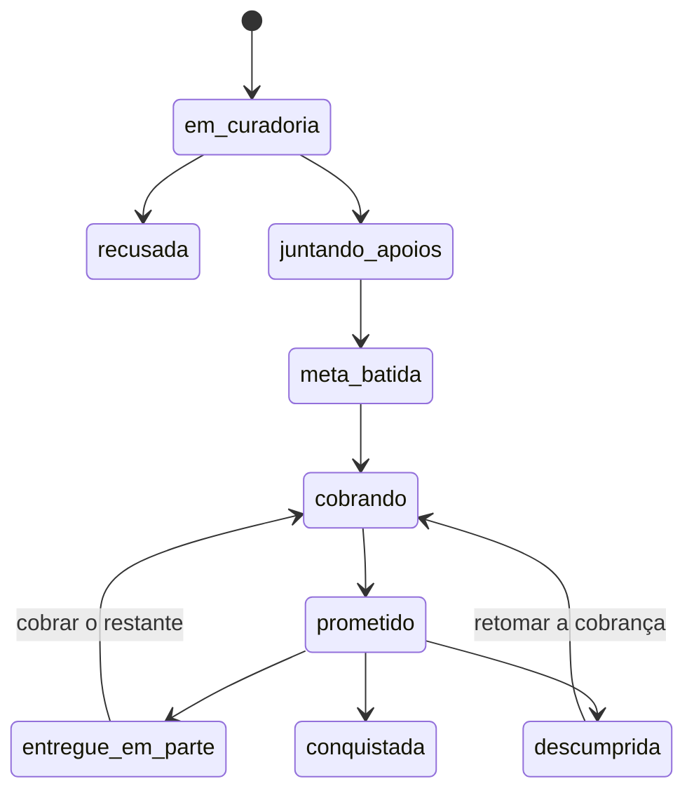

# SCRUM-80 · Esquema e contratos para validação

> **Estado: PREPARAÇÃO.** Este material ainda não representa a versão estável da T7. A validação
> das partes 2 a 5 e as decisões pendentes devem ser registradas em
> [`decisoes.md`](decisoes.md) antes do congelamento.

Fontes executáveis: [`schema.ts`](../packages/db/src/schema.ts),
[`migrations/`](../packages/db/migrations/) e [`index.ts` do domínio](../packages/dominio/src/index.ts).
O contrato detalhado da T4 continua em [`database/schema.md`](database/schema.md).

## Roteiro da apresentação (15–20 min)

1. Esquema e invariantes do banco — 4 min.
2. Status e transições — 4 min.
3. Funções do domínio e regra de escrita — 4 min.
4. Eventos da linha do tempo — 4 min.
5. Decisões e pedidos das partes — 4 min.

## Diagrama ER simples

As tabelas operacionais `codigo_verificacao`, `conversa` e `mensagem_processada` não se ligam por
FK às entidades do diagrama. Suas chaves de telefone e wamid usam HMAC, e o código de verificação
usa hash. `conversa` também mantém estado e payload privado em JSONB; o banco não garante cifra nem
valida automaticamente dados pessoais nesse payload. A lista de campos, nulabilidade, índices e
constraints está no [contrato da T4](database/schema.md#campos-nulabilidade-e-defaults).

## Status e transições

O enum `status_pauta` contém exatamente nove valores:

| Ordem | Status técnico      | Papel no fluxo atual                                             |
| ----: | ------------------- | ---------------------------------------------------------------- |
|     1 | `em_curadoria`      | pauta aguardando análise                                         |
|     2 | `recusada`          | pauta encerrada pela curadoria; conteúdo da recusa não é público |
|     3 | `juntando_apoios`   | pauta aprovada buscando a meta                                   |
|     4 | `meta_batida`       | quantidade mínima de apoios alcançada                            |
|     5 | `cobrando`          | encaminhamento ou cobrança em andamento                          |
|     6 | `prometido`         | existe promessa com entrega e conferência                        |
|     7 | `entregue_em_parte` | conferência reconheceu entrega parcial                           |
|     8 | `descumprida`       | conferência reconheceu descumprimento                            |
|     9 | `conquistada`       | objetivo entregue                                                |

O caminho principal e os três resultados finais abaixo são usados pelo seed da T6. A SCRUM-80
define que, quando reabertas, pautas em `entregue_em_parte` ou `descumprida` voltam para `cobrando`;
só o registro de uma nova promessa leva de `cobrando` a `prometido`. O diagrama documenta o contrato
decidido, mas a máquina de estados ainda precisa ser implementada no serviço único de regras.

`recusada` e `conquistada` são terminais. `entregue_em_parte` e `descumprida` não são terminais:
permanecem encerradas até uma reabertura explícita, que as leva a `cobrando`.

## Funções e regra única do domínio

### Disponíveis hoje

| Função              | Responsabilidade                                         | Efeito persistente |
| ------------------- | -------------------------------------------------------- | ------------------ |
| `calcularMeta`      | aplica mínimo 30, máximo 300 e 10% da base do bloco      | nenhum             |
| `conferirAnonimato` | bloqueia dados conhecidos e sinaliza possíveis nomes     | nenhum             |
| `planejarEnvio`     | deduplica e prioriza disparos dentro do orçamento diário | nenhum             |

Essas são as únicas funções públicas de regra exportadas hoje por `@lumens/dominio`. As operações
de escrita abaixo são a proposta de contrato a fechar com as partes; os nomes e assinaturas ainda
**não** devem ser tratados como API implementada:

| Operação proposta          | Resultado atômico esperado                                     | Evento relacionado              |
| -------------------------- | -------------------------------------------------------------- | ------------------------------- |
| `criarPauta`               | persistir a pauta em curadoria com a meta congelada            | `pauta_criada`                  |
| `aprovarPauta`             | aprovar e iniciar a busca de apoios                            | `pauta_aprovada`                |
| `recusarPauta`             | registrar motivo e encerrar a pauta sem publicação             | `pauta_recusada`                |
| `registrarApoio`           | garantir um apoio por estudante e detectar a meta              | `meta_batida`, quando aplicável |
| `abrirCaminho`             | criar um encaminhamento                                        | `caminho_aberto`                |
| `registrarProtocolo`       | associar protocolo ao caminho                                  | `protocolo_registrado`          |
| `publicarProposta`         | abrir proposta com necessidade de voluntários                  | `proposta_publicada`            |
| `executarProposta`         | concluir a proposta como conquista parcial                     | `proposta_executada`            |
| `registrarRespostaOficial` | anexar a resposta recebida ao acompanhamento                   | `resposta_oficial_recebida`     |
| `registrarPromessa`        | criar uma promessa ativa e sua janela de conferência           | `promessa_registrada`           |
| `abrirConferencia`         | abrir a coleta de respostas dos apoiadores                     | `conferencia_aberta`            |
| `apurarConferencia`        | encerrar a coleta e aplicar o resultado                        | `conferencia_apurada`           |
| `alterarStatus`            | validar e persistir uma transição permitida                    | `status_alterado`               |
| `adicionarOwner`           | iniciar um mandato respeitando o limite de responsáveis ativos | `owner_entrou`                  |
| `removerOwner`             | encerrar um mandato sem apagar o histórico                     | `owner_removido`                |
| `aprovarRelato`            | concluir a moderação e liberar o relato                        | `relato_aprovado`               |

A auditoria técnica dos consumidores está em [`decisoes.md`](decisoes.md). A confirmação humana de
cada parte continua obrigatória antes de declarar que a apresentação ocorreu.

### Contrato de escrita

- Código de aplicação não grava diretamente nas tabelas de negócio.
- Toda escrita passa por `@lumens/dominio`, que valida a regra, persiste a mudança e inclui o evento
  correspondente na mesma transação.
- O PostgreSQL já impede `UPDATE`, `DELETE` e `TRUNCATE` em `evento`; a linha do tempo é append-only.
- Migration, provisionamento, teste e seed são ferramentas de infraestrutura. O seed da T6 ainda
  insere fixtures diretamente e mantém um `TODO(T9)` para usar o domínio quando essas funções
  existirem; isso não autoriza escrita direta em runtime.

## Tipos de evento decididos

O catálogo contém os quinze tipos propostos pela SCRUM-80 e preserva `pauta_criada`, já emitido pelo
seed. `evento.tipo` continua sendo `text`: fechar nomes na T7 não exige migration. Uma constraint ou
enum no banco só deve ser criada se a equipe decidir que a validação também pertence à persistência.

| Tipo                        | Visibilidade | Observação                                 |
| --------------------------- | ------------ | ------------------------------------------ |
| `pauta_criada`              | não público  | criação em `em_curadoria`                  |
| `pauta_aprovada`            | público      | início da coleta de apoios                 |
| `pauta_recusada`            | não público  | decisão da curadoria                       |
| `meta_batida`               | público      | meta alcançada                             |
| `caminho_aberto`            | público      | novo encaminhamento                        |
| `protocolo_registrado`      | público      | protocolo vinculado ao caminho             |
| `proposta_publicada`        | público      | proposta aberta a voluntários              |
| `proposta_executada`        | público      | conquista parcial                          |
| `resposta_oficial_recebida` | público      | resposta anexada à pauta                   |
| `promessa_registrada`       | público      | compromisso e data de entrega              |
| `conferencia_aberta`        | público      | início da janela de sete dias              |
| `conferencia_apurada`       | público      | resultado consolidado                      |
| `status_alterado`           | condicional  | não público quando `dados.para = recusada` |
| `owner_entrou`              | público      | início de mandato                          |
| `owner_removido`            | público      | fim de mandato                             |
| `relato_aprovado`           | público      | moderação concluída                        |

### Payloads mínimos

`pauta_id`, `tipo`, `origem`, `publico` e `criado_em` pertencem às colunas de `evento` e não são
duplicados em `dados`. O JSONB contém somente os campos abaixo; campos adicionais são compatíveis
quando não expõem dados pessoais e consumidores ignoram chaves desconhecidas.

| Tipo                        | `dados` mínimo                                              |
| --------------------------- | ----------------------------------------------------------- |
| `pauta_criada`              | `{ status: "em_curadoria" }`                                |
| `pauta_aprovada`            | `{}`                                                        |
| `pauta_recusada`            | `{}` — o motivo permanece na pauta e o evento não é público |
| `meta_batida`               | `{ meta, apoios }`                                          |
| `caminho_aberto`            | `{ caminho_id, tipo }`                                      |
| `protocolo_registrado`      | `{ caminho_id, protocolo }`                                 |
| `proposta_publicada`        | `{ proposta_id, pessoas_necessarias }`                      |
| `proposta_executada`        | `{ proposta_id }`                                           |
| `resposta_oficial_recebida` | `{ caminho_id }`                                            |
| `promessa_registrada`       | `{ promessa_id, data_entrega }`                             |
| `conferencia_aberta`        | `{ promessa_id, fecha_em }`                                 |
| `conferencia_apurada`       | `{ promessa_id, resultado, total_respostas }`               |
| `status_alterado`           | `{ de, para }`                                              |
| `owner_entrou`              | `{ papel }`                                                 |
| `owner_removido`            | `{ papel }`                                                 |
| `relato_aprovado`           | `{ relato_id }`                                             |

Regras do payload:

- instantes usam ISO 8601 em UTC; datas civis, como `data_entrega`, usam `YYYY-MM-DD`;
- nenhum evento carrega ID de estudante/curador, telefone, e-mail, nome de pessoa, texto livre de
  pauta/relato ou outro dado pessoal;
- conteúdo livre permanece na entidade de origem e a API pública monta uma projeção permitida;
- depois do congelamento deste contrato, remover ou renomear campo exige um novo tipo de evento;
  adicionar campo opcional é compatível;
- o seed novo usa `{ status: "em_curadoria" }` em `pauta_criada`; fixtures carregadas antes da T7
  permanecem com `titulo` porque a reaplicação usa `onConflictDoNothing()`, sem backfill;
- `status_alterado` mantém `{ de, para }`, o payload já usado pelo seed da T6.

### Decisão sobre `pauta_criada`

`pauta_criada` integra o catálogo final como evento não público. A decisão preserva o histórico de
criação que o seed já registra sem expor pautas ainda em curadoria.

## Perguntas que encerram a validação

- Cada parte consegue consumir o schema e os eventos acima sem campo ou operação adicional?
- As partes 2 a 5 confirmam a auditoria técnica ou precisam de algum campo/operação adicional?
